# Visão geral

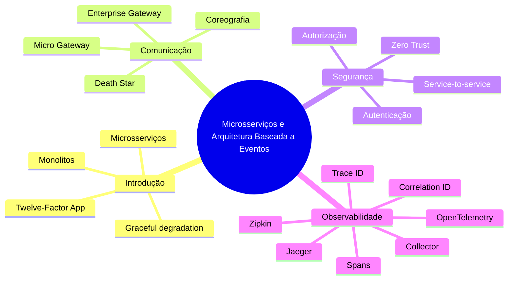

# Fundamentos de Microsserviços

## Monolito

Um sistema monolítico concentra várias áreas e escopos dentro da mesma aplicação. É mais simples para começar, facilita comunicação e atende muitos cenários, mas pode gerar riscos de deploy, limitação tecnológica e dificuldade de evolução quando cresce demais.

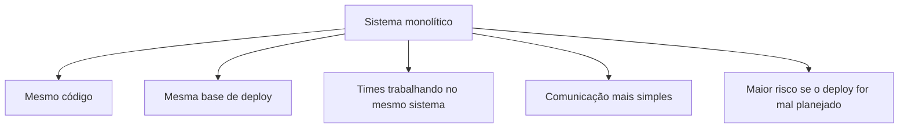

**Para memorizar:** monolito não é necessariamente ruim; ele costuma ser mais simples no início, mas pode ficar difícil de evoluir conforme escopo, times e complexidade aumentam.

## Microsserviços

Microsserviços são aplicações independentes, autônomas e com escopo bem definido. Cada serviço resolve uma parte do negócio e participa de um ecossistema maior.

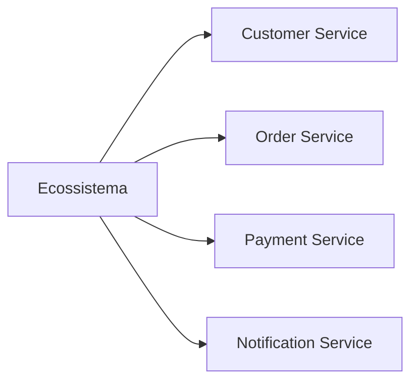

**Vantagens principais:** independência, autonomia, possibilidade de tecnologias diferentes, deploys menos arriscados e melhor organização por domínio.

**Custos principais:** setup mais complexo, observabilidade mais difícil, múltiplas esteiras de CI/CD e troubleshooting mais complicado.

## Monolito x Microsserviços

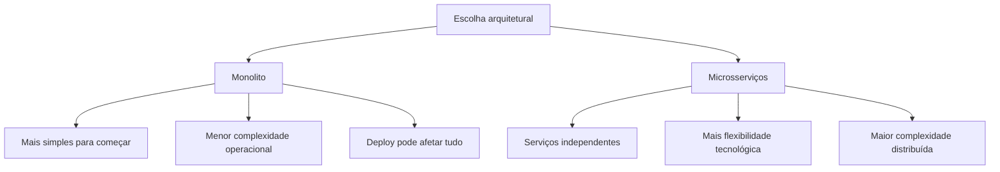

**Resumo direto:** microsserviços ajudam escala organizacional e técnica, mas não eliminam complexidade; eles deslocam a complexidade para rede, observabilidade, deploy, segurança e consistência.

## Graceful Degradation

Graceful degradation é a capacidade de o sistema continuar funcionando mesmo quando uma parte falha, ainda que com funcionalidades reduzidas.

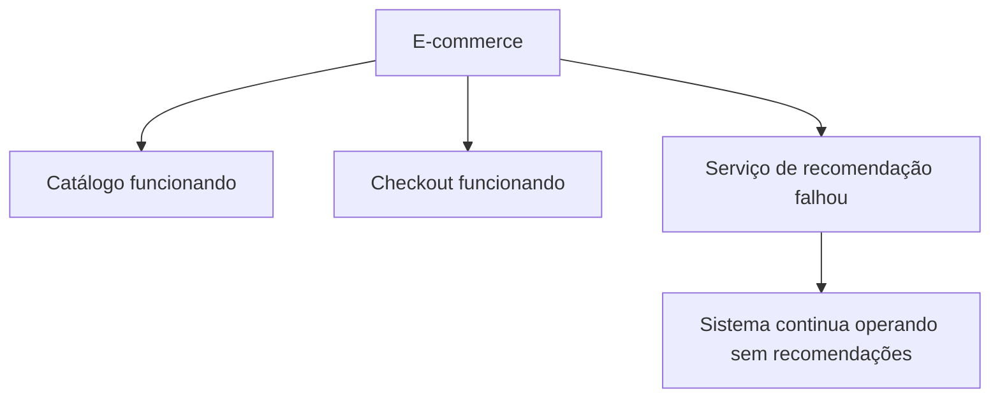

**Para memorizar:** falhou uma parte, mas o sistema continua entregando o essencial.

## Twelve-Factor App

The Twelve-Factor App é uma metodologia para construir aplicações SaaS/cloud-native escaláveis, portáveis e fáceis de manter.

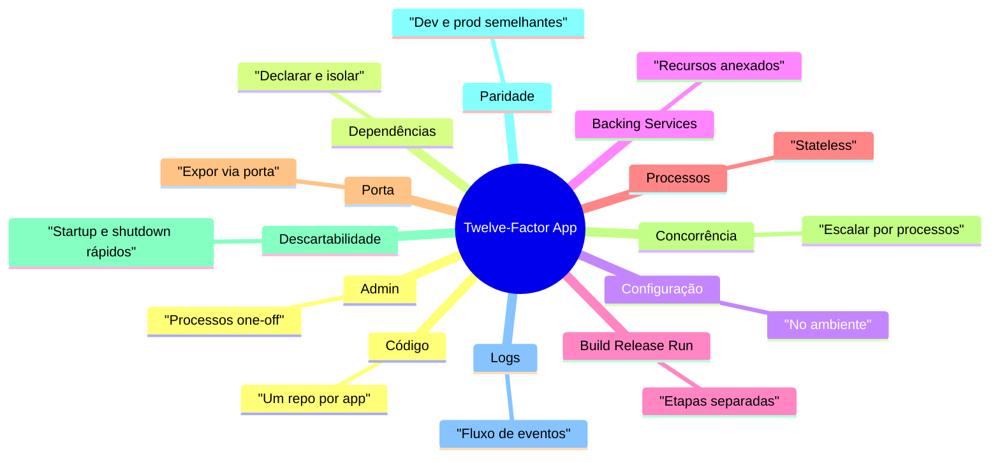

**Resumo direto:** é um guia para aplicações preparadas para CI/CD, escala horizontal, cloud e portabilidade entre ambientes.

# Comunicação e Gateways

## Coreografia x Death Star

Na coreografia, cada serviço reage a eventos e executa sua parte sem um coordenador central. Na arquitetura Death Star, os serviços ficam excessivamente dependentes entre si, criando um monolito distribuído.

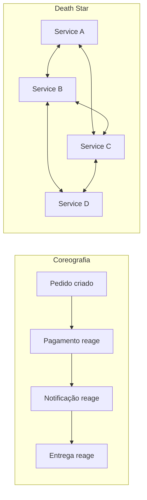

**Resumo direto:** coreografia reduz acoplamento, mas dificulta rastreabilidade; Death Star aumenta acoplamento, fragilidade e dificuldade de manutenção.

## Enterprise Gateway

Enterprise Gateway é a porta de entrada centralizada da organização. Ele evita que clientes acessem diretamente cada microsserviço.

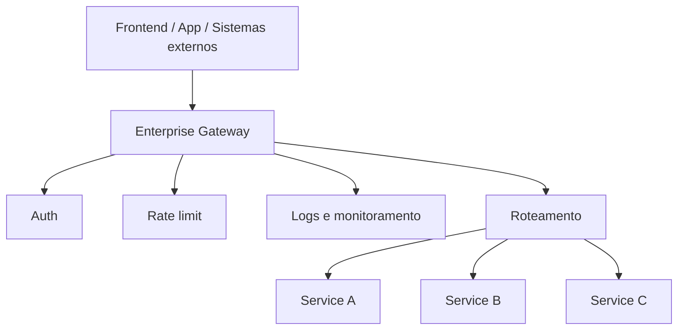

**Responsabilidades:** roteamento, autenticação, autorização, rate limiting, segurança, logs, monitoramento e transformação de requests/responses.

## Micro Gateway

Micro Gateway tem escopo menor que o Enterprise Gateway. Ele organiza a entrada para um domínio ou conjunto específico de microsserviços.

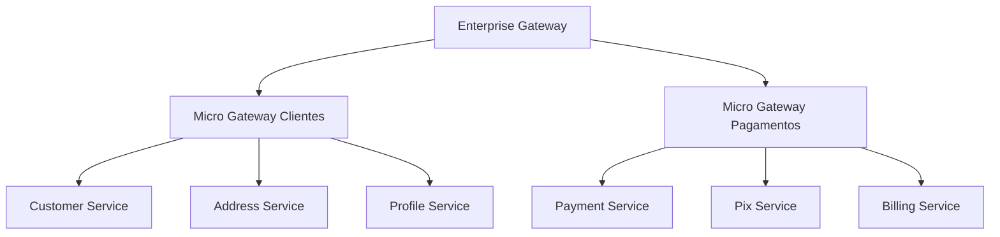

**Para memorizar:** Enterprise Gateway é a entrada global; Micro Gateway é a entrada de um domínio.

# Segurança em Microsserviços

## Autenticação e Autorização

Autenticação responde quem está fazendo a requisição. Autorização responde o que essa identidade pode fazer.

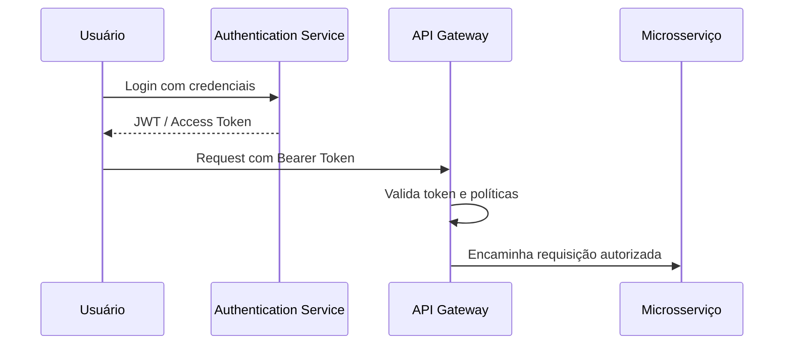

**Resumo direto:** autenticação identifica; autorização permite ou nega ações.

## Service-to-Service Auth

Nem toda autenticação envolve usuário. Em microsserviços, um serviço também precisa provar sua identidade para outro serviço.

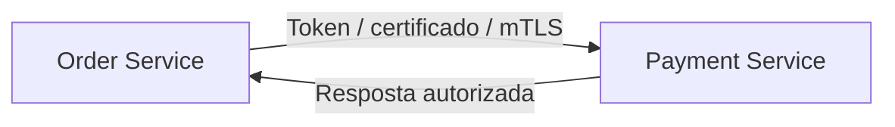

**Exemplos comuns:** OAuth2 Client Credentials, certificados e mTLS.

## Redes Internas e Zero Trust

Estar dentro da rede interna não significa ser confiável. Em arquiteturas modernas, aplica-se Zero Trust: nenhuma chamada deve ser aceita apenas porque veio de dentro da infraestrutura.

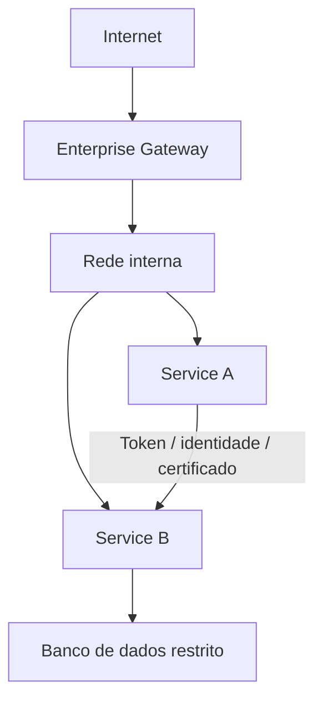

**Para memorizar:** rede interna reduz exposição, mas não substitui autenticação, autorização e controle de acesso.

# Observabilidade Distribuída

## Correlation ID

Correlation ID é um identificador usado para acompanhar uma mesma requisição enquanto ela passa por vários componentes.

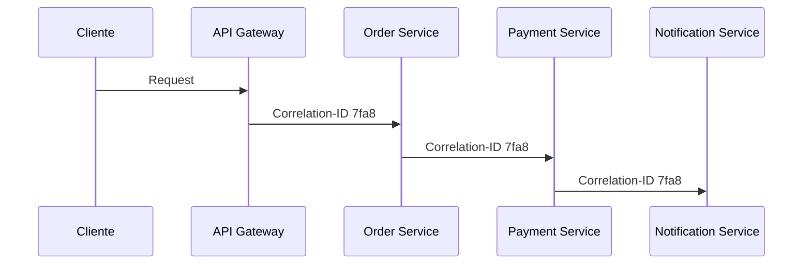

**Resumo direto:** facilita encontrar logs e eventos relacionados à mesma operação.

## Tracing, Trace ID e Span

Tracing acompanha o caminho completo de uma requisição em sistemas distribuídos. Trace ID identifica o fluxo completo. Span representa uma operação dentro desse fluxo.

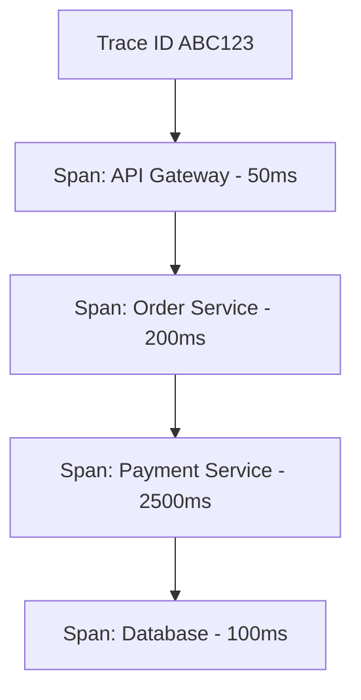

**Para memorizar:** trace é a jornada completa; span é cada etapa relevante dessa jornada.

## OpenTelemetry

OpenTelemetry é um padrão/ecossistema open source para instrumentar, gerar, coletar e exportar dados de observabilidade.

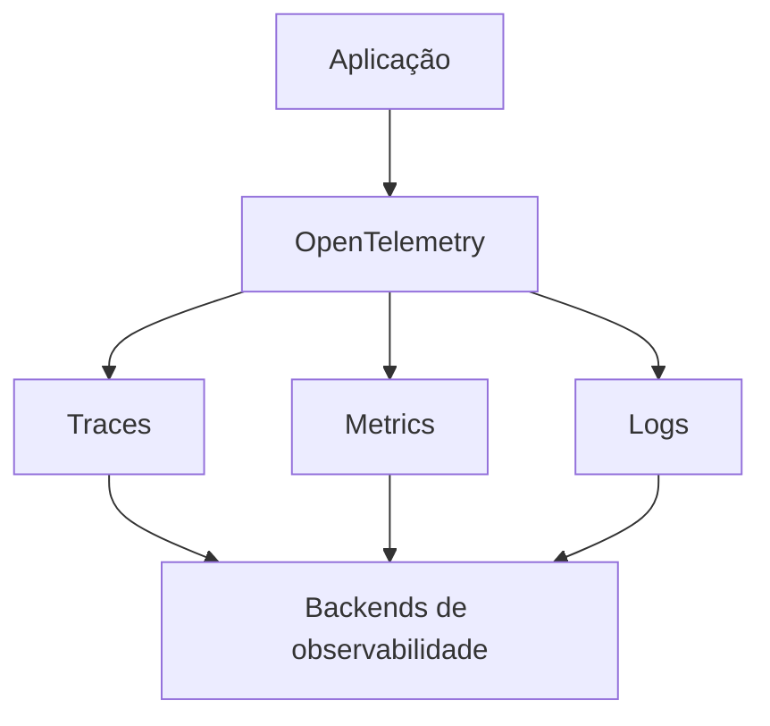

**Resumo direto:** OpenTelemetry não é apenas uma tela de visualização; ele padroniza a instrumentação e o envio de telemetria.

## OpenTelemetry Collector

O Collector recebe, processa e exporta dados de telemetria. Ele funciona como intermediário entre aplicações e backends de observabilidade.

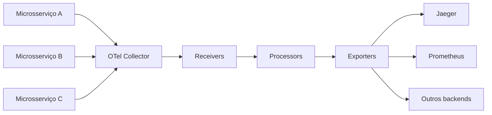

**Para memorizar:** Collector recebe, processa e exporta.

## Jaeger e Zipkin

Jaeger e Zipkin são ferramentas/backends de distributed tracing. Elas ajudam a visualizar traces, tempos de execução, erros e chamadas entre serviços.

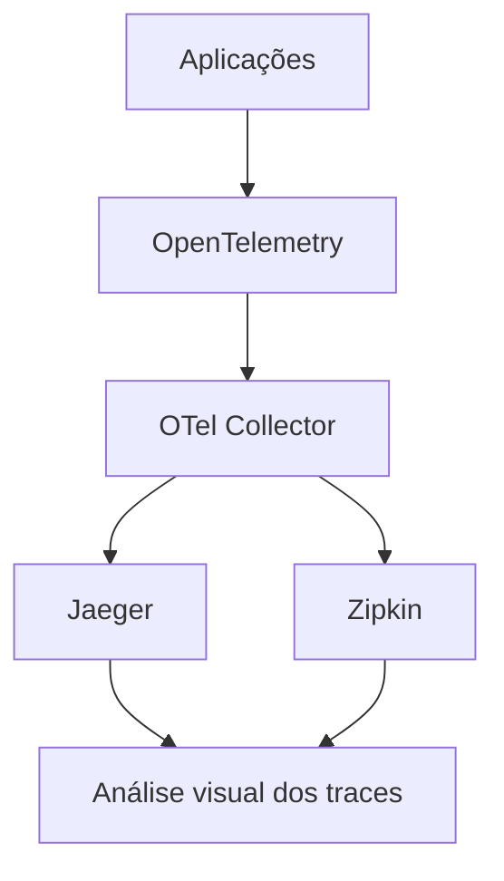

**Resumo direto:** OpenTelemetry instrumenta e padroniza; Collector encaminha; Jaeger e Zipkin permitem analisar traces.

## Fluxo completo de observabilidade

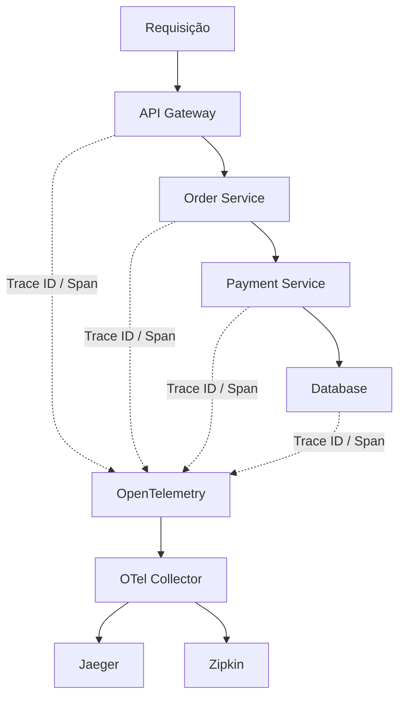

**Frase para decorar:** OpenTelemetry gera e padroniza telemetria; Collector recebe, processa e encaminha; Jaeger e Zipkin armazenam/analisam traces; Trace ID conecta spans; Correlation ID ajuda a correlacionar logs e eventos.

# Arquitetura Baseada a Eventos

## Introdução a EDA

EDA, ou Event-Driven Architecture, é uma arquitetura orientada a eventos. Em vez de um serviço chamar outro diretamente para executar todo o fluxo, os serviços publicam e consomem eventos.

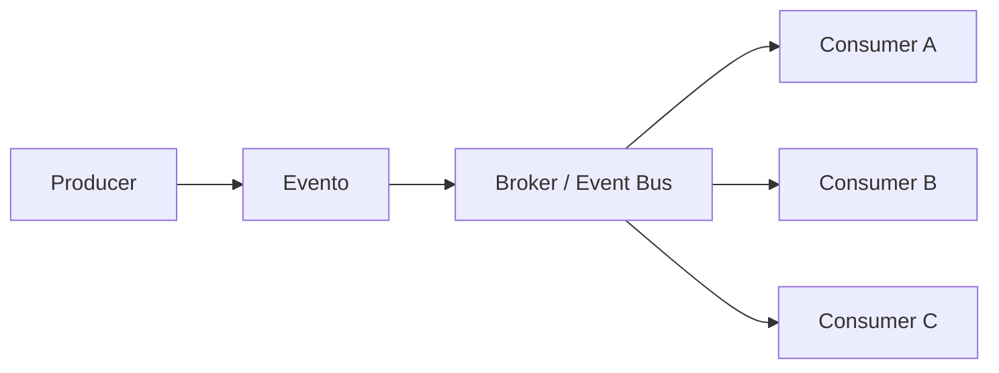

**Resumo direto:** EDA reduz acoplamento temporal entre serviços, melhora extensibilidade e favorece processamento assíncrono, mas exige cuidado com consistência eventual, rastreabilidade, duplicidade e versionamento de eventos.

## Event Notification

Event Notification é o padrão em que o evento avisa que algo aconteceu, mas carrega poucos dados. O consumidor normalmente precisa buscar mais detalhes em outro serviço.

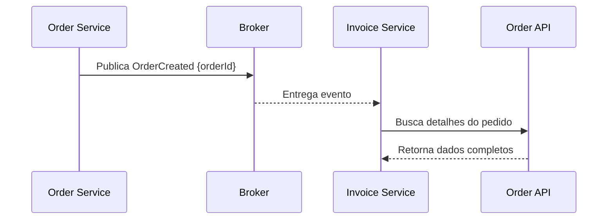

**Vantagem:** evento pequeno e simples.

**Cuidado:** pode criar dependência extra, mais chamadas de rede e risco de o dado ter mudado quando for consultado.

## Event-Carried State Transfer

Event-Carried State Transfer é o padrão em que o evento carrega os dados necessários para o consumidor agir sem precisar consultar o serviço de origem.

```mermaid
sequenceDiagram
    participant O as Order Service
    participant B as Broker
    participant I as Invoice Service

    O->>B: Publica OrderCreated {id, customer, items, total}
    B-->>I: Entrega evento com estado necessário
    I->>I: Processa sem chamar Order Service
```

**Vantagem:** reduz chamadas síncronas e melhora autonomia do consumidor.

**Cuidado:** eventos ficam maiores e exigem mais atenção com dados sensíveis, versionamento e compatibilidade.

## Event Sourcing

Event Sourcing é um padrão em que o estado atual não é salvo diretamente como uma linha final em uma tabela. O sistema salva a sequência de eventos que levou ao estado atual.

```mermaid
flowchart TD
    A["Conta criada"] --> B["Depósito realizado"]
    B --> C["Saque realizado"]
    C --> D["Transferência recebida"]
    D --> E["Estado atual reconstruído"]
```

**Resumo direto:** em vez de salvar apenas `saldo = 500`, salvamos os eventos que explicam como o saldo chegou a esse valor.

**Vantagens:** histórico completo, auditoria forte, possibilidade de reconstruir estado e criar novas projeções.

**Cuidados:** aumenta complexidade, exige modelagem cuidadosa de eventos, snapshots podem ser necessários e mudanças de schema precisam ser bem controladas.

## Schemas Evolutivos

Schemas evolutivos permitem que eventos mudem ao longo do tempo sem quebrar produtores e consumidores.

```mermaid
flowchart TD
    A["Evento v1"] --> B["id, total"]
    A --> C["Evento v2"]
    C --> D["id, total, customerId"]
    C --> E["Consumidores antigos continuam funcionando"]
```

**Boas práticas:** adicionar campos opcionais, evitar remover ou renomear campos usados, manter compatibilidade retroativa e versionar mudanças relevantes.

**Para memorizar:** evento publicado vira contrato; mudar contrato sem cuidado quebra consumidores.

## Schema Registry

Schema Registry é um repositório central de schemas dos eventos. Ele ajuda a validar, versionar e garantir compatibilidade entre producers e consumers.

```mermaid
flowchart LR
    A["Producer"] --> B["Schema Registry"]
    B --> C["Valida schema"]
    A --> D["Broker"]
    E["Consumer"] --> B
    D --> E
```

**Resumo direto:** funciona como catálogo e controle de contrato dos eventos.

**Benefícios:** reduz quebra entre serviços, facilita evolução de eventos e aumenta governança em arquiteturas assíncronas.

# CQRS

## Falando sobre CQRS

CQRS significa Command Query Responsibility Segregation. A ideia é separar operações de escrita, chamadas de commands, das operações de leitura, chamadas de queries.

```mermaid
flowchart TD
    A["Aplicação"] --> B["Commands"]
    A --> C["Queries"]
    B --> D["Modelo de escrita"]
    C --> E["Modelo de leitura"]
```

**Resumo direto:** command muda estado; query consulta estado. Separar os dois permite otimizar escrita e leitura de formas diferentes.

## Conceitos Básicos Sobre CQRS

No CQRS, comandos representam intenção de mudança. Consultas representam necessidade de leitura. O modelo de escrita protege regras de negócio; o modelo de leitura é otimizado para responder rápido.

```mermaid
flowchart LR
    A["CreateOrderCommand"] --> B["Command Handler"]
    B --> C["Regras de negócio"]
    C --> D["Banco de escrita"]
    D --> E["Evento OrderCreated"]
    E --> F["Projeção de leitura"]
    G["GetOrderQuery"] --> H["Query Handler"]
    H --> F
```

**Para memorizar:** command não retorna consulta complexa; query não altera estado.

## Banco de Dados no CQRS

CQRS pode usar o mesmo banco ou bancos separados. O ponto principal não é obrigatoriamente ter dois bancos, mas separar os modelos de escrita e leitura.

```mermaid
flowchart TD
    A["CQRS"] --> B["Mesmo banco"]
    A --> C["Bancos separados"]
    B --> D["Separação lógica"]
    C --> E["Banco transacional para escrita"]
    C --> F["Banco otimizado para leitura"]
```

**Mesmo banco:** mais simples, menor complexidade operacional.

**Bancos separados:** mais flexível e escalável, mas exige sincronização e aceita consistência eventual.

## Mecanismos de Sincronização

Quando escrita e leitura ficam separadas, é preciso sincronizar o modelo de leitura com as mudanças do modelo de escrita.

```mermaid
flowchart LR
    A["Command"] --> B["Modelo de escrita"]
    B --> C["Evento de domínio"]
    C --> D["Broker"]
    D --> E["Projection Handler"]
    E --> F["Read Model"]
```

**Mecanismos comuns:** eventos, filas, brokers, CDC, outbox pattern e projections.

**Cuidado principal:** a leitura pode ficar temporariamente atrasada em relação à escrita.

## Mecanismos de Sincronização Pt02

Em arquiteturas distribuídas, a sincronização precisa lidar com falhas, reprocessamento e idempotência.

```mermaid
flowchart TD
    A["Evento publicado"] --> B{"Consumer processou?"}
    B -->|"Sim"| C["Atualiza read model"]
    B -->|"Não"| D["Retry"]
    D --> E{"Estourou limite?"}
    E -->|"Não"| B
    E -->|"Sim"| F["Dead Letter Queue"]
```

**Pontos importantes:** consumers devem ser idempotentes, mensagens podem chegar mais de uma vez, ordem pode importar e falhas precisam de retry ou DLQ.

## Exemplo Prático de Commands

Commands expressam uma intenção de mudança no sistema. Normalmente usam verbo no imperativo e são processados por command handlers.

```mermaid
sequenceDiagram
    participant API as API
    participant H as Command Handler
    participant D as Domínio
    participant DB as Banco Escrita
    participant B as Broker

    API->>H: CreateOrderCommand
    H->>D: Valida regras de negócio
    D-->>H: Pedido criado
    H->>DB: Persiste mudança
    H->>B: Publica OrderCreated
```

**Exemplos:** `CreateOrderCommand`, `CancelOrderCommand`, `ApprovePaymentCommand`.

## Exemplo Prático de Queries

Queries consultam dados e não devem alterar estado. Elas podem usar modelos desnormalizados, views ou bancos otimizados para leitura.

```mermaid
sequenceDiagram
    participant UI as Interface
    participant QH as Query Handler
    participant RM as Read Model

    UI->>QH: GetOrderDetailsQuery
    QH->>RM: Busca dados prontos para tela
    RM-->>QH: Dados do pedido
    QH-->>UI: Resultado
```

**Exemplos:** `GetOrderByIdQuery`, `ListCustomerOrdersQuery`, `SearchProductsQuery`.

# Sagas e Orquestração

## Saga

Saga é um padrão para coordenar transações distribuídas entre microsserviços. Em vez de uma transação ACID única envolvendo tudo, cada serviço executa uma transação local e publica eventos para continuar o processo.

```mermaid
flowchart LR
    A["Criar pedido"] --> B["Reservar estoque"]
    B --> C["Processar pagamento"]
    C --> D["Confirmar pedido"]
```

**Resumo direto:** Saga controla processos longos e distribuídos usando passos locais, eventos/comandos e compensações em caso de falha.

## Dinâmica de uma Saga

Uma Saga pode ser coreografada ou orquestrada.

```mermaid
flowchart TD
    A["Saga"] --> B["Coreografia"]
    A --> C["Orquestração"]
    B --> D["Serviços reagem a eventos"]
    C --> E["Um orquestrador comanda os passos"]
```

**Coreografia:** menos centralização, mas mais difícil de rastrear.

**Orquestração:** fluxo mais explícito e rastreável, mas adiciona componente coordenador.

## Compensação e Gerenciamento de Erros

Compensação é uma ação que desfaz ou neutraliza uma etapa já concluída quando uma etapa posterior falha.

```mermaid
flowchart TD
    A["Pedido criado"] --> B["Estoque reservado"]
    B --> C["Pagamento falhou"]
    C --> D["Compensar: liberar estoque"]
    D --> E["Marcar pedido como cancelado"]
```

**Resumo direto:** como não existe uma transação global simples, cada etapa precisa prever como reagir a falhas.

**Cuidados:** retries, timeout, idempotência, DLQ, estados intermediários e monitoramento.

## Draft de Código

Um draft de código para CQRS/Saga geralmente separa comandos, handlers, eventos e queries.

```mermaid
classDiagram
    class CreateOrderCommand {
      customerId
      items
    }
    class CreateOrderHandler {
      handle(command)
    }
    class OrderCreatedEvent {
      orderId
      total
    }
    class GetOrderQuery {
      orderId
    }
    class GetOrderHandler {
      handle(query)
    }

    CreateOrderCommand --> CreateOrderHandler
    CreateOrderHandler --> OrderCreatedEvent
    GetOrderQuery --> GetOrderHandler
```

**Para memorizar:** commands mudam estado, events comunicam fatos, queries leem dados.

## AWS Step Functions

AWS Step Functions é um serviço da AWS para orquestrar workflows. Ele pode ser usado para implementar sagas orquestradas, coordenando chamadas, decisões, retries e compensações.

```mermaid
stateDiagram-v2
    [*] --> CreateOrder
    CreateOrder --> ReserveStock
    ReserveStock --> ProcessPayment
    ProcessPayment --> ConfirmOrder: sucesso
    ProcessPayment --> ReleaseStock: falha
    ReleaseStock --> CancelOrder
    ConfirmOrder --> [*]
    CancelOrder --> [*]
```

**Resumo direto:** Step Functions ajuda a visualizar e controlar fluxos distribuídos, especialmente quando há múltiplos passos, falhas e compensações.

# Referências e Revisão

## Microservices.io

Microservices.io é uma referência conhecida sobre padrões de microsserviços, mantida por Chris Richardson. Ela documenta padrões como Saga, CQRS, Database per Service, API Gateway, Event Sourcing e Transactional Outbox.

```mermaid
mindmap
  root((Microservices.io))
    Saga
    CQRS
    Event Sourcing
    Database per Service
    API Gateway
    Transactional Outbox
```

**Resumo direto:** é uma fonte útil para revisar padrões, trade-offs e problemas recorrentes em arquiteturas de microsserviços.
